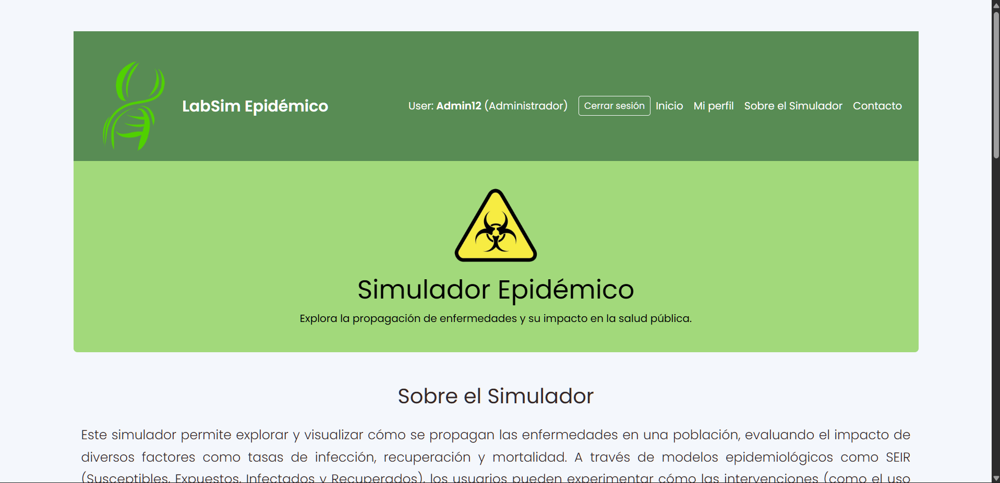

# Simulador de Ecosistema Epidemiológico (SEIRD)
Proyecto Original : https://github.com/ThePacktur/SimuladorEcosistema

Proyecto Realizado con Django y MYSQL Workbench.

 

# Novedades
- Pagina de perfil de usuario.
- Pequeños cambios de diseño.
- Rol de profesor, estudiante, administrador.

# Instalacion en Windows

1. Descargar el archivo S.E.I.R.D-Project-main.zip y descomprimirlo.

2. Abrir el archivo desde visual studio code.

3. Introduccir la serie de comandos:

- python -m venv env

En MySQL workbench para crear la base de datos:
- CREATE DATABASE SEIRD_DB CHARACTER SET utf8mb4;

- powershell: .\env\Scripts\Activate.ps1

- pip install -r .\requirements.txt

- python manage.py runserver

Nota:
crear un admin desde 'python manage.py createsuperuser'.
Los profesores solo son creados apartir de un administrador.
Los estudiantes son creados manualmente y administrado por un admin.

